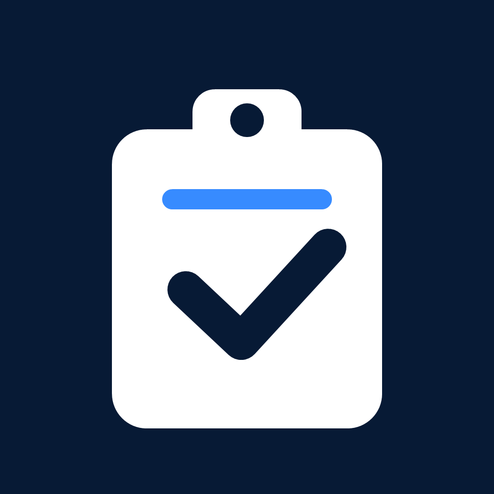
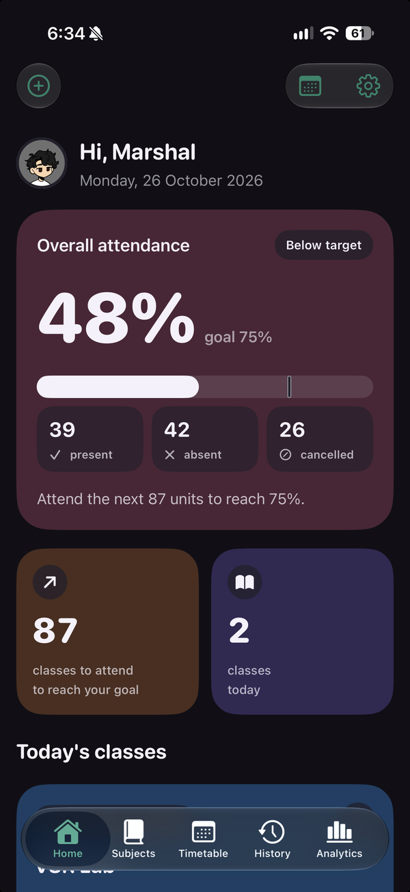
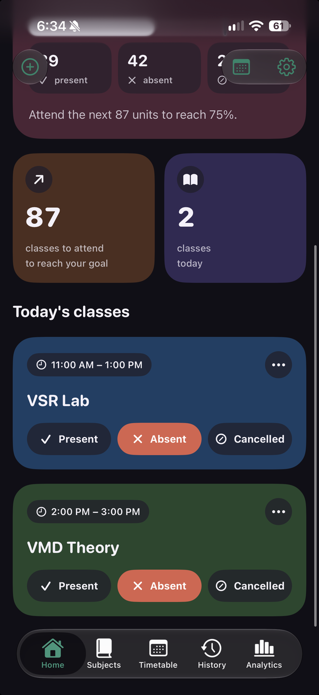
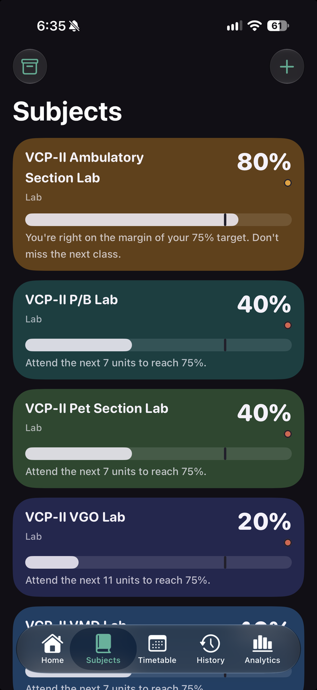

<div align="center">



# AttendSmartly for iOS

**Track classes. Plan bunks. Attend smartly.**

A native SwiftUI attendance tracker for college students, with a safe-bunk calculator,
timetable, history and analytics. Everything stays on your iPhone.

[](https://github.com/NevamindHaze/AttendSmartly/actions/workflows/ios-build.yml)
[](#requirements)
[](#tech-stack)
[](LICENSE)

</div>

<p align="center">
  
  &nbsp;
  
  &nbsp;
  
</p>

## Features

- **Today at a glance.** Your overall attendance, how many classes you need to attend to reach your goal (or how many you can safely miss), and today's classes with one-tap Present, Absent and Cancelled buttons.
- **Safe-bunk calculator.** Every subject shows its percentage against its own target, plus a plain-language verdict such as "Attend the next 7 units to reach 75%".
- **Multi-unit classes.** A two-hour lab can count as two attendance units, each marked separately.
- **Timetable.** A weekly schedule with a day picker, per-class rooms and teachers, and optional start and end dates.
- **Any date.** Review or mark attendance for past and future days, add extra classes, cancel a class or reschedule it.
- **History.** Every recorded class, grouped by date, with quick fixes for wrong marks.
- **Analytics.** Overall progress, best and weakest subjects, a subject ranking, per-subject bars against goals and a weekly trend.
- **Holidays and semesters.** Holidays hide that day's classes. Semester tracking limits the numbers to a date range.
- **Class reminders.** Optional weekly notifications before each class.
- **Backup and restore.** Import and export JSON backups. The format is compatible with the original AttendSmartly Android app, and merging the same backup twice never creates duplicates.
- **Light and dark.** Soft pastel tiles by day, deep jewel tones by night. Add your own name and profile photo.

## Install

AttendSmartly is not on the App Store. It is installed with [SideStore](https://sidestore.io).

1. Set up SideStore on your iPhone and sign in with your Apple ID inside SideStore.
2. In SideStore, open **Sources**, tap **+**, and add:

   ```
   https://github.com/NevamindHaze/AttendSmartly/releases/download/ios-latest/source.json
   ```

3. Open the AttendSmartly source and install the app.

Every successful build on `main` is published to this source automatically, so updates appear in SideStore under **My Apps**.

Moving over from the Android app? Export a backup there, open AttendSmartly on iOS, tap your profile picture to open Settings, and choose **Import backup → Replace**.

## Build from source

You need a Mac with Xcode 16 or later.

```bash
git clone https://github.com/NevamindHaze/AttendSmartly.git
cd AttendSmartly
open AttendSmartly.xcodeproj
```

Select the **AttendSmartly** scheme and run it on a simulator or device. There are no third-party dependencies. To run the unit tests, press **⌘U**.

Without a Mac, push to GitHub: the [Build iOS App](.github/workflows/ios-build.yml) workflow builds the app on a macOS runner, runs the tests and publishes an unsigned IPA.

## Requirements

- iOS 17.0 or later (iPhone)
- Xcode 16 or later to build

## Tech stack

| Area | Choice |
| --- | --- |
| UI | SwiftUI |
| Storage | SwiftData, on device only |
| Charts | Swift Charts |
| Notifications | UserNotifications (local, scheduled weekly) |
| CI | GitHub Actions on macOS runners |
| Distribution | Unsigned IPA plus a SideStore source |

## Project structure

```
AttendSmartly/            App source
  AttendSmartlyApp.swift  App entry point and data store
  Models.swift            SwiftData models (subjects, timetable, sessions, units, holidays)
  AttendanceCalculator.swift  Percentage, safe-bunk and recovery maths
  BackupService.swift     JSON import and export
  HomeView.swift          Home screen
  SubjectsView.swift      Subjects list and subject form
  TimetableView.swift     Weekly timetable and class form
  HistoryView.swift       Attendance history and editing
  AnalyticsView.swift     Charts, ranking and insights
  SettingsView.swift      Profile, reminders, semester, backup
  Pastel.swift, Theme.swift   Colours, tiles and shared components
AttendSmartlyTests/       Unit tests and a backup fixture
.github/workflows/        Build, test and publish workflow
```

## Privacy

AttendSmartly has no accounts, servers or analytics. Your data and profile photo stay on your device. See [PRIVACY.md](PRIVACY.md).

## Credits and license

This iOS app is a SwiftUI port of [AttendSmartly](https://github.com/agupta07505/AttendSmartly), the open-source Android app by **Animesh Gupta**. The attendance logic, feature set and backup format follow the original project. The iOS code in this repository was written in 2026 and maintained by [NevamindHaze](https://github.com/NevamindHaze).

The original Android source code is preserved on the [`android-archive`](https://github.com/NevamindHaze/AttendSmartly/tree/android-archive) branch.

Licensed under the [GNU General Public License v3.0](LICENSE), the same license as the original project.
